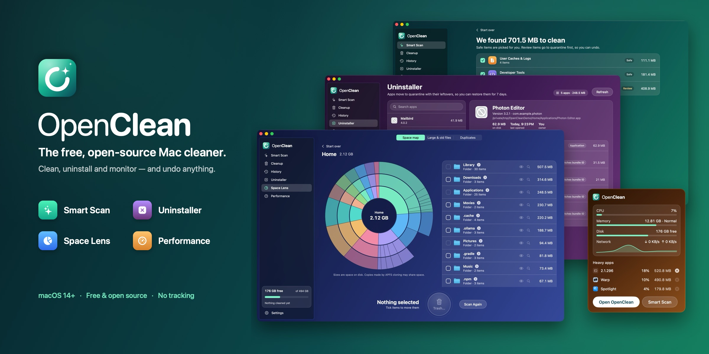

<p align="center">
  
</p>

<p align="center">
  <strong>Free, open-source Mac cleaner — a transparent CleanMyMac alternative for macOS.</strong><br>
  Clear caches, logs, Xcode DerivedData, npm/Gradle/Cargo caches and AI model leftovers, with undo.
</p>

<p align="center">
  <a href="https://github.com/leoAnimesh/OpenClean/releases/latest"></a>
  <a href="https://github.com/leoAnimesh/OpenClean/actions/workflows/ci.yml"></a>
  
  
  <a href="LICENSE"></a>
</p>

OpenClean is a native macOS disk cleanup app and command-line tool. Smart Scan finds caches, logs,
developer-tool and AI-tool leftovers you can safely remove, shows you exactly why each item is safe, and
keeps anything that is not trivially regenerable in a quarantine you can restore from for 7 days.
No accounts, no analytics, no tracking — every cleaning rule is readable YAML.

## Features

- **Smart Scan** — one click to find System Junk, user caches and logs, browser caches, Trash, Mail
  attachments and old iOS backups.
- **Uninstaller** — remove apps together with their leftovers (Application Support, caches, preferences,
  containers, launch agents); everything goes to quarantine so an uninstall can be undone.
- **Space Lens** — an interactive disk space map, a large & old files finder and a duplicate file finder;
  removals go to the macOS Trash and nothing is ever pre-selected.
- **Performance & menu bar monitor** — live CPU, memory, disk and network in the menu bar, heavy apps with
  Quit/Force Quit, login items and launch agents, and one-click maintenance (flush DNS, reindex Spotlight,
  rebuild Launch Services, thin Time Machine snapshots).
- **Developer cleanup** — Xcode DerivedData, archives, device support and simulators; package caches for
  npm/npx, Yarn, pnpm, Bun, Deno, Corepack, pip, uv, Poetry, conda, Cargo, Go (build and module caches),
  Gradle, Maven, Coursier, Ivy,
  SwiftPM, CocoaPods, pub, Bundler, Composer, Terraform and Homebrew; Playwright, Puppeteer, Cypress and
  Electron downloads; JetBrains indexes and VS Code / Cursor caches; Docker disk image reporting.
- **Old project cleanup** — finds `node_modules`, Python virtual environments, Rust `target` folders and
  build output (SwiftPM, Maven, Gradle, Flutter, Next.js and more) in projects you haven't touched for 30
  days; they go to quarantine, so a project can be restored as it was. Projects in Documents or Desktop are
  searched only if you add their folder under Settings → Project folders.
- **AI model cleanup** — Ollama, LM Studio, Hugging Face (models, datasets, Xet), PyTorch Hub, Whisper,
  Keras, TensorFlow Datasets and Kaggle downloads.
- **Safe by design** — Safe / Review / Caution levels, a hard deny-list, pre-delete checks, and a
  quarantine with **History and Restore** (undo for 1–90 days).
- **Transparent rules** — every rule explains itself in the app; write and lint your own YAML packs.
- **CLI with JSON output** — script `openclean scan` / `clean` in CI or dotfiles.
- **Software Update** — OpenClean checks GitHub once a day for a new release (you can turn this off),
  downloads and verifies it, installs it in place and relaunches; the previous version stays in History.
- **Scan reminder (optional, off by default)** — weekly or monthly, a read-only Smart Scan runs in the
  background while OpenClean or its menu bar item is running and tells you how much can be cleaned. It
  never cleans by itself.
- **Native and private** — Swift 6 + SwiftUI, no telemetry, GPL-3.0.

## Why OpenClean

| CleanMyMac | OpenClean |
|---|---|
| App Store build is sandboxed and asks for folders one by one | Full Disk Access once, plus an admin prompt only for system caches |
| Most removals are permanent | Quarantine with History and Restore |
| Cleaning logic is a black box | Every rule is readable YAML with an explanation, shown in the app |
| Rules come only from the vendor | Community rule packs, linted in CI; add your own |
| Analytics, accounts, upsell | No analytics or accounts; the only network use is the daily update check |
| GUI only | App and a scriptable CLI with JSON output |
| General junk focus | First-class Xcode, npm, Cargo, Gradle, Docker, Ollama, Hugging Face and old-project cleanup |

## Install

### Download (recommended)

Get the latest `OpenClean-X.Y.Z.dmg` from the
[Releases page](https://github.com/leoAnimesh/OpenClean/releases/latest), open it and drag OpenClean onto
Applications. It's a universal build (Apple silicon and Intel) and needs macOS 14 or later. The same
release has `openclean-cli-X.Y.Z.zip` (the CLI plus its rule packs) and `SHA256SUMS.txt`
(`shasum -a 256 -c SHA256SUMS.txt`).

Releases are signed with a Developer ID and notarized by Apple, so they open like any other app.

Releases are published automatically when changes are merged to `main` (see
[CONTRIBUTING.md](CONTRIBUTING.md#releases--versioning)).

### Homebrew

This repository is also a Homebrew tap:

```sh
brew install --cask leoanimesh/openclean/openclean   # the app (same signed, notarized DMG)
brew install leoanimesh/openclean/openclean          # the openclean CLI (release build)
brew install --HEAD leoanimesh/openclean/openclean   # the CLI built from the latest main (needs Xcode 16+)
```

The app keeps itself up to date (Settings → Updates), so `brew upgrade` leaves the cask alone unless you
pass `--greedy`; `brew upgrade openclean` updates the CLI. The tap follows a new release shortly after it
is published. `brew uninstall --zap --cask openclean` removes the app's preferences and caches but keeps
`~/Library/Application Support/OpenClean`, which holds your quarantine (files you can still restore).

### Updates and privacy

OpenClean checks api.github.com once a day for a new release (you can turn this off in Settings → Updates
or on the last onboarding step); **OpenClean → Check for Updates…** always works. The check sends only
`User-Agent: OpenClean/<version>`; nothing about you or your files is sent. Updates are downloaded only
from GitHub, checked against the release's `SHA256SUMS.txt` and the app's code signature, and installed in
place; your previous version is kept in History, so you can restore it. An update must be signed by the
same Apple developer team as the app you have. Apart from this, OpenClean makes no network requests.

### Build from source

Requires macOS 14+ and Xcode 16+.

```sh
git clone https://github.com/leoAnimesh/OpenClean.git
cd OpenClean
make install          # app → /Applications, CLI → /usr/local/bin (may need sudo)
```

### Full Disk Access

Trash, Mail, Safari and iOS backups live in protected folders. Grant access in
System Settings → Privacy & Security → Full Disk Access. The grant survives updates of the released app.
A build from source is signed ad hoc, so each rebuild gets a new signature: remove OpenClean from that
list and add it again; the app tells you when.

## Using the CLI

```sh
openclean scan                          # what can be removed, nothing is touched
openclean scan --category developer --json
openclean clean --dry-run               # show the plan
openclean clean --yes                   # remove regenerable items
openclean clean --yes --include-review  # also quarantine review items
openclean history
openclean restore <session-id>
openclean rules list | explain xcode.derived-data | lint my-pack.yaml
openclean schedule purge --daily        # optional daily purge of expired quarantine

openclean apps list [--json]            # installed apps, their leftovers and sizes (read-only)
openclean apps uninstall com.example.app --dry-run
openclean apps uninstall com.example.app --yes   # app + bundle-id leftovers to quarantine
openclean space large --min-size 500MB --older-than 180 [--json]   # read-only
openclean space duplicates [--json]     # identical files in Downloads, Desktop, Documents, Pictures, Movies, Music
openclean performance [--json]          # CPU/memory snapshot and the heaviest apps (read-only)
```

Exit codes: `0` success, `1` error or aborted, `2` finished but some items were skipped.

`openclean clean --json` requires `--yes` or `--dry-run`, so scripted runs never clean by accident.
When `openclean clean` is not run from a terminal, system items that need the administrator password are
skipped (with a note on stderr) unless you pass `--allow-admin`.

`openclean apps uninstall` follows the same rules: it asks before moving anything (or needs `--yes`; it
refuses on a non-terminal without it), `--json` needs `--yes` or `--dry-run`, and an app owned by the system
(which needs your administrator password) is refused when not run from a terminal unless you pass
`--allow-admin`. Leftovers named after the bundle identifier are moved with the app; ones matched only by
the app's name stay unless you add `--include-name-matches`, and items in `/Library` always stay. The
whole uninstall is one quarantine session, so `openclean restore <session-id>` brings it back. If several
apps share a bundle identifier, pick one with `--path`. `space` and `performance` never remove or quit
anything; use the app to move files to the Trash or quit processes.

## How it stays safe

- A built-in deny-list (System, your Documents/Desktop, Keychains, Mail, iCloud Drive, app bundles,
  Photos libraries) can never be removed, whatever a rule says. The one exception is opt-in: folders such
  as `node_modules` that the old-project search finds inside a project folder you chose in Settings may
  go to quarantine even under Documents or Desktop; nothing else there is touched. Deny-list checks are byte-level and
  aware of Unicode normalization and letter case, so look-alike spellings of a protected path do not
  slip through.
- Symlinks are never followed; a match that resolves outside its rule's folder is dropped.
- Right before removal, items that changed since the scan, are open in another app, or belong to an app
  that is now running are skipped and logged.
- `regenerable` items are deleted; `review` and `caution` items go to quarantine first.
- Administrator deletions only run where every parent folder is root-protected.
- Only two modules in the codebase can remove files, and a test enforces it.

## Writing rules

See [CONTRIBUTING.md](CONTRIBUTING.md#writing-a-rule). Your own packs go in
`~/Library/Application Support/OpenClean/rules/`.

## Clean-room statement

OpenClean's feature set was informed by inspecting CleanMyMac's App Store bundle metadata and
user-facing strings. No MacPaw code, binaries, rule data or assets were decompiled, copied or used.

## License

GPL-3.0. See [LICENSE](LICENSE).
