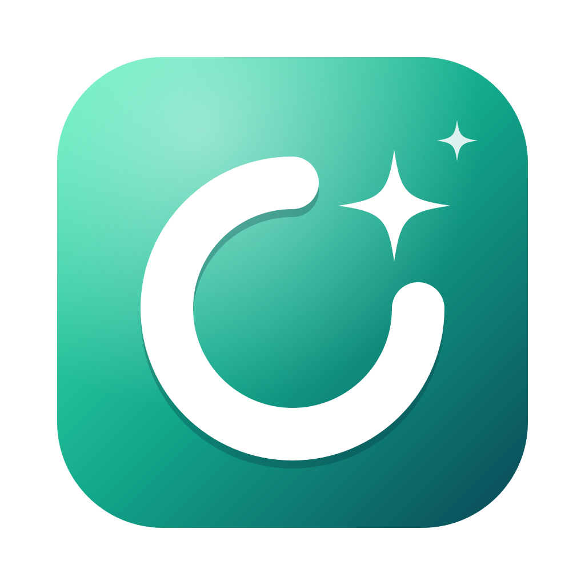
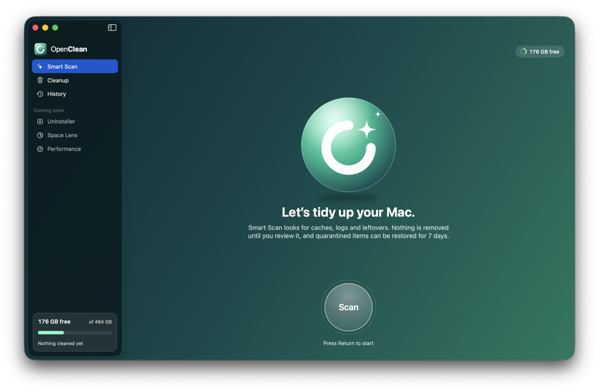
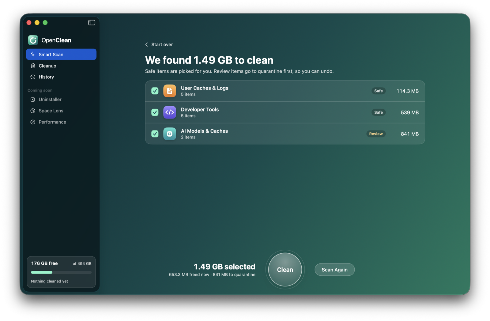
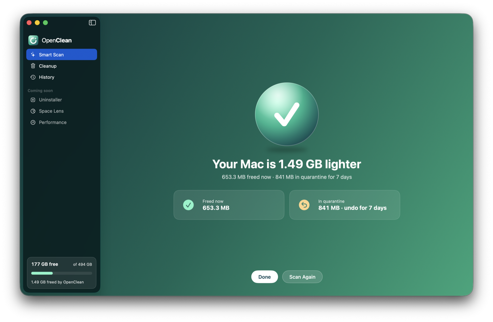
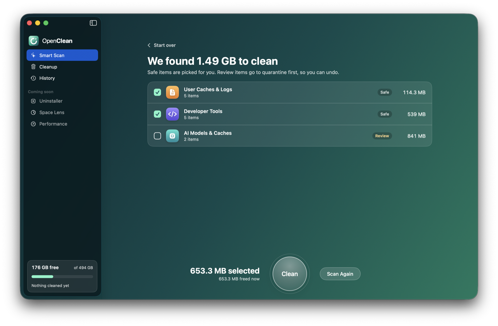
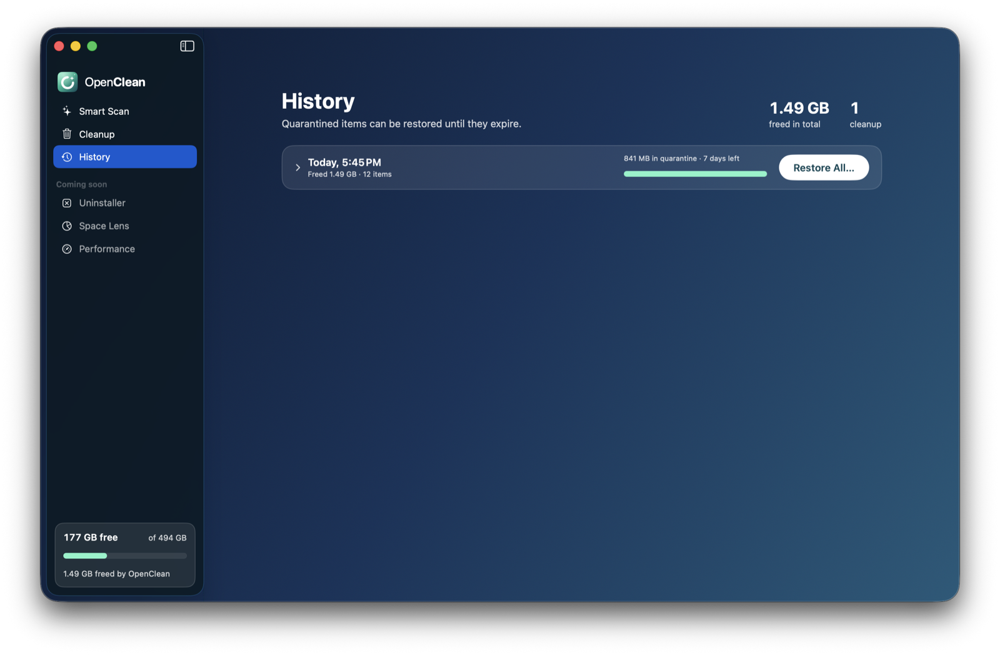

<p align="center">
  
</p>

<h1 align="center">OpenClean</h1>

<p align="center">
  <strong>Free, open-source Mac cleaner — a transparent CleanMyMac alternative for macOS.</strong><br>
  Clear caches, logs, Xcode DerivedData, npm/Gradle/Cargo caches and AI model leftovers, with undo.
</p>

<p align="center">
  <a href="https://github.com/leoAnimesh/OpenClean/actions/workflows/ci.yml"></a>
  
  
  
  <a href="LICENSE"></a>
</p>

<p align="center">
  
</p>

OpenClean is a native macOS disk cleanup app and command-line tool. Smart Scan finds caches, logs,
developer-tool and AI-tool leftovers you can safely remove, shows you exactly why each item is safe, and
keeps anything that is not trivially regenerable in a quarantine you can restore from for 7 days.
No accounts, no analytics, no network access — every cleaning rule is readable YAML.

## Screenshots

| Smart Scan results | Cleanup complete |
|---|---|
|  |  |
| **Scanning** | **History & restore** |
|  |  |

## Features

- **Smart Scan** — one click to find System Junk, user caches and logs, browser caches, Trash, Mail
  attachments and old iOS backups.
- **Developer cleanup** — Xcode DerivedData, archives, device support and simulators; npm, Yarn, pnpm,
  pip, Cargo, Gradle, CocoaPods and Homebrew caches; Docker disk image reporting.
- **AI model cleanup** — Ollama, LM Studio and Hugging Face caches.
- **Safe by design** — Safe / Review / Caution levels, a hard deny-list, pre-delete checks, and a
  quarantine with **History and Restore** (undo for 1–90 days).
- **Transparent rules** — every rule explains itself in the app; write and lint your own YAML packs.
- **CLI with JSON output** — script `openclean scan` / `clean` in CI or dotfiles.
- **Native and private** — Swift 6 + SwiftUI, no telemetry, GPL-3.0.

## Why OpenClean

| CleanMyMac | OpenClean |
|---|---|
| App Store build is sandboxed and asks for folders one by one | Full Disk Access once, plus an admin prompt only for system caches |
| Most removals are permanent | Quarantine with History and Restore |
| Cleaning logic is a black box | Every rule is readable YAML with an explanation, shown in the app |
| Rules come only from the vendor | Community rule packs, linted in CI; add your own |
| Analytics, accounts, upsell | No network access at all |
| GUI only | App and a scriptable CLI with JSON output |
| General junk focus | First-class Xcode, npm, Cargo, Gradle, Docker, Ollama, Hugging Face cleanup |

## Install (build from source)

Requires macOS 14+ and Xcode 16+.

```sh
git clone https://github.com/leoAnimesh/OpenClean.git
cd OpenClean
make install          # app → /Applications, CLI → /usr/local/bin (may need sudo)
```

CLI only, via Homebrew (builds from the latest source):

```sh
brew tap leoanimesh/openclean https://github.com/leoAnimesh/OpenClean
brew install --HEAD openclean
```

Releases on GitHub include an unsigned app zip and the CLI. Because the app is not notarized, right-click
→ Open the first time.

### Full Disk Access

Trash, Mail, Safari and iOS backups live in protected folders. Grant access in
System Settings → Privacy & Security → Full Disk Access. Each rebuild of an unsigned app gets a new
signature, so after updating, remove OpenClean from that list and add it again; the app tells you when.

## Using the CLI

```sh
openclean scan                          # what can be removed, nothing is touched
openclean scan --category developer --json
openclean clean --dry-run               # show the plan
openclean clean --yes                   # remove regenerable items
openclean clean --yes --include-review  # also quarantine review items
openclean history
openclean restore <session-id>
openclean rules list | explain xcode.derived-data | lint my-pack.yaml
openclean schedule purge --daily        # optional daily purge of expired quarantine
```

Exit codes: `0` success, `1` error or aborted, `2` finished but some items were skipped.

`openclean clean --json` requires `--yes` or `--dry-run`, so scripted runs never clean by accident.
When `openclean clean` is not run from a terminal, system items that need the administrator password are
skipped (with a note on stderr) unless you pass `--allow-admin`.

## How it stays safe

- A built-in deny-list (System, your Documents/Desktop, Keychains, Mail, iCloud Drive, app bundles,
  Photos libraries) can never be removed, whatever a rule says. Deny-list checks are byte-level and
  aware of Unicode normalization and letter case, so look-alike spellings of a protected path do not
  slip through.
- Symlinks are never followed; a match that resolves outside its rule's folder is dropped.
- Right before removal, items that changed since the scan, are open in another app, or belong to an app
  that is now running are skipped and logged.
- `regenerable` items are deleted; `review` and `caution` items go to quarantine first.
- Administrator deletions only run where every parent folder is root-protected.
- Only two modules in the codebase can remove files, and a test enforces it.

## Writing rules

See [CONTRIBUTING.md](CONTRIBUTING.md#writing-a-rule). Your own packs go in
`~/Library/Application Support/OpenClean/rules/`.

## Clean-room statement

OpenClean's feature set was informed by inspecting CleanMyMac's App Store bundle metadata and
user-facing strings. No MacPaw code, binaries, rule data or assets were decompiled, copied or used.

## License

GPL-3.0. See [LICENSE](LICENSE).
